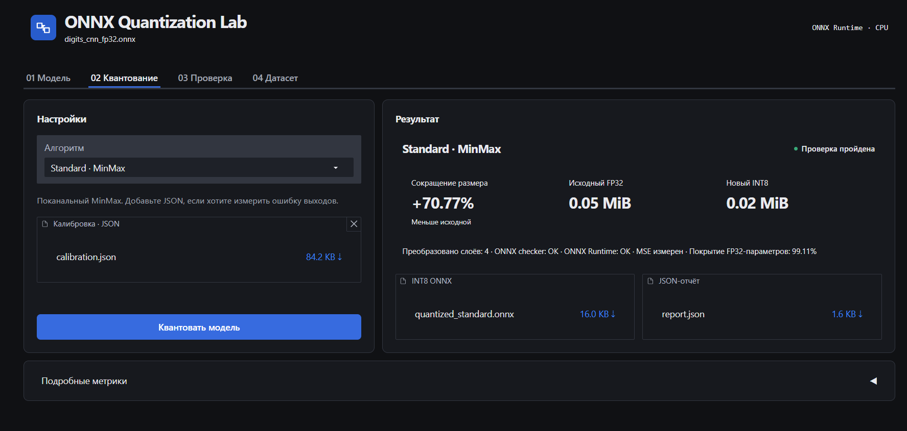

# ONNX Quantization Lab

[](https://github.com/lukianchik/onnx-quant/actions/workflows/ci.yml) · [](https://github.com/lukianchik/onnx-quant/releases) · [](LICENSE)

[Русский](README.md)

Adaptive INT8 weight quantization for ONNX models with robust candidate selection and progressive optimization. Reduce model size, compare numerical outputs and evaluate quality on labeled datasets.



## Quick start

Requires Docker and Docker Compose (Docker Desktop with Linux containers on Windows).

```sh
git clone https://github.com/lukianchik/onnx-quant.git
cd onnx-quant
docker compose up -d --build quantlab
```

Open [http://127.0.0.1:7860](http://127.0.0.1:7860). The first build downloads dependencies and demo assets.

## Features

- ONNX graph inspection and per-channel quantization of MatMul, Gemm and Conv weights.
- Four modes with different quantization search costs.
- Adaptive modes check numerical outputs on held-out calibration batches and fall back to MinMax if the acceptance criteria are not met.
- Original and quantized model comparison: output error, accuracy, macro F1 and prediction agreement.
- ONNX export and JSON reports.

## Quantization modes

| Mode | Method | Calibration |
| --- | --- | --- |
| Standard | Per-channel MinMax | Optional |
| Fast | Single-Robust | At least 5 batches |
| Balanced | Progressive | At least 5 batches |
| Quality | Progressive-Global | At least 6 batches |

## Results

The v4 research benchmark evaluated eight models across three seeds. The metric is the mean of model medians of the maximum output-wise MSE ratio to MinMax; lower is better.

| Mode | Relative MSE |
| --- | ---: |
| Standard | 1.0000 |
| Fast | 0.6435 |
| Balanced | 0.5444 |
| Quality | 0.5011 |

These results come from the research benchmark using a prebuilt candidate bank, not a timing measurement of the current application. [Protocol and full report](research/results/12_benchmark_v4_final/README.md).

Application check on Digits CNN (Standard):

| Metric | Result |
| --- | ---: |
| Model size reduction | 70.77% |
| FP32 parameter coverage | 99.11% |
| Accuracy before / after | 98.66% / 98.66% |
| Prediction agreement | 373/373 |
| FP32 / INT8 speed ratio | 0.86× |

[Digits CNN evaluation report](docs/images/digits-evaluation.png). This result covers a single model and dataset.

## Limitations

Constant FP32 and FP16 weights are supported: INT8 storage, `DequantizeLinear` and restoration of the original type. Faster inference is not guaranteed. Execution is CPU-based, with partial ONNX operator support and opset ≥ 13. See the guide for compatibility and input formats. Untrusted models require suitable isolation.

## Documentation

- [User and developer guide](docs/USAGE.en.md)
- [Mathematics](docs/MATHEMATICS.md) · [References](docs/REFERENCES.md)
- [Research and reproduction](research/README.md)
- [Changelog](CHANGELOG.md) · [Security](SECURITY.md)

## License

[Apache License 2.0](LICENSE). Third-party models, datasets and dependencies: [THIRD_PARTY.md](THIRD_PARTY.md).
