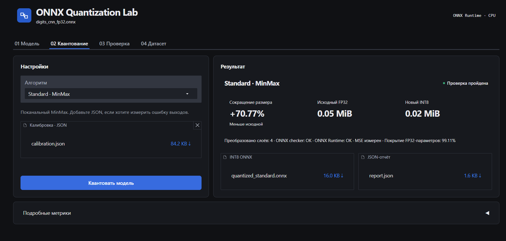

# ONNX Quantization Lab

[](https://github.com/lukianchik/onnx-quant/actions/workflows/ci.yml) · [](https://github.com/lukianchik/onnx-quant/releases) · [](LICENSE)

[English](README.en.md)

Инструмент адаптивного INT8-квантования весов ONNX-моделей с робастным выбором кандидатов и прогрессивной оптимизацией. Позволяет уменьшать размер модели, сравнивать численные выходы и оценивать качество на размеченных данных.



## Быстрый запуск

Требуются Docker и Docker Compose (на Windows — Docker Desktop в режиме Linux-контейнеров).

```sh
git clone https://github.com/lukianchik/onnx-quant.git
cd onnx-quant
docker compose up -d --build quantlab
```

Откройте [http://127.0.0.1:7860](http://127.0.0.1:7860). Первая сборка загружает зависимости и демонстрационные данные.

## Возможности

- Анализ ONNX-графа и поканальное квантование весов MatMul, Gemm и Conv.
- Четыре режима с различной стоимостью поиска параметров квантования.
- В адаптивных режимах — проверка численных выходов на отложенной калибровочной выборке с возвратом к MinMax при отсутствии улучшения.
- Сравнение исходной и квантованной модели: ошибка выходов, Accuracy, macro F1 и совпадение предсказаний.
- Экспорт ONNX и JSON-отчётов.

## Режимы квантования

| Режим | Метод | Калибровка |
| --- | --- | --- |
| Standard | Поканальный MinMax | Необязательна |
| Fast | Single-Robust | От 5 пакетов |
| Balanced | Progressive | От 5 пакетов |
| Quality | Progressive-Global | От 6 пакетов |

## Результаты

В исследовании v4 сравнивались 8 моделей с тремя значениями seed. Метрика — среднее модельных медиан максимального по выходам отношения MSE к MinMax; меньше — лучше.

| Режим | Относительный MSE |
| --- | ---: |
| Standard | 1.0000 |
| Fast | 0.6435 |
| Balanced | 0.5444 |
| Quality | 0.5011 |

Это результаты исследовательского стенда с заранее построенным банком кандидатов, а не измерение скорости текущего приложения. [Методика и полный отчёт](research/results/12_benchmark_v4_final/README.ru.md).

Проверка приложения на Digits CNN (Standard):

| Метрика | Результат |
| --- | ---: |
| Сокращение размера | 70,77% |
| Покрытие FP32-параметров | 99,11% |
| Accuracy до / после | 98,66% / 98,66% |
| Совпадение предсказаний | 373/373 |
| Отношение скорости FP32 / INT8 | 0,86× |

[Отчёт оценки Digits CNN](docs/images/digits-evaluation.png). Результат относится к одной модели и выборке.

## Ограничения

Поддерживаются постоянные FP32- и FP16-веса: хранение INT8, деквантование через `DequantizeLinear` и восстановление исходного типа. Это не гарантирует ускорения инференса. Исполнение — на CPU; поддерживается часть операторов ONNX, opset ≥ 13. Подробности совместимости и форматы входов описаны в руководстве. Безопасность недоверенных моделей требует отдельной изоляции.

## Документация

- [Руководство пользователя и разработчика](docs/USAGE.md)
- [Математические основы](docs/MATHEMATICS.md) · [Литература](docs/REFERENCES.md)
- [Исследование и воспроизведение результатов](research/README.md)
- [История версий](CHANGELOG.md) · [Безопасность](SECURITY.md)

## Лицензия

[Apache License 2.0](LICENSE). Условия использования сторонних моделей, данных и зависимостей: [THIRD_PARTY.md](THIRD_PARTY.md).
